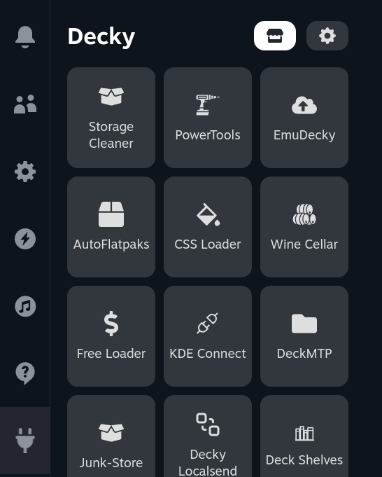

# Grid Menu

A Decky plugin that shows the plugin list in Decky's Quick Access tab as a grid
instead of a long list. It uses three columns by default. You can switch to two
or four columns or turn the grid off on the Grid Menu page.

Grid Menu rearranges Decky's own buttons, so plugin order, icons, update badges
and the hidden and disabled plugin counts stay the same. The D-pad moves through
the grid, and pressing up from the first row selects the header buttons. Plugin
pages, Decky's settings and the store keep their normal layout. Disabling or
uninstalling Grid Menu brings the list back right away.

The plugin has no backend and makes no network requests. Settings are saved in
Steam's browser storage.

## Install

1. Download `decky-grid-menu-<version>.zip` from the
   [latest release](https://github.com/D3SOX/decky-grid-menu/releases/latest).
   Use the ZIP under Assets. The "Source code" archives don't contain the
   built plugin.
2. Copy it to your Steam Deck.
3. In Decky's settings, enable Developer Mode, then choose Install Plugin from
   ZIP and select the file.

## Compatibility

Grid Menu works with Decky Loader 3.3.1 on the stable Steam client and with the
Decky 4.0.0 pre-release on the Steam client beta.

Decky has no API for changing its menu layout, so Grid Menu reads Decky's
internal menu state. A Decky or Steam update can break that. If the state isn't
available, Grid Menu leaves the original list in place.

## License

[MIT](LICENSE)
